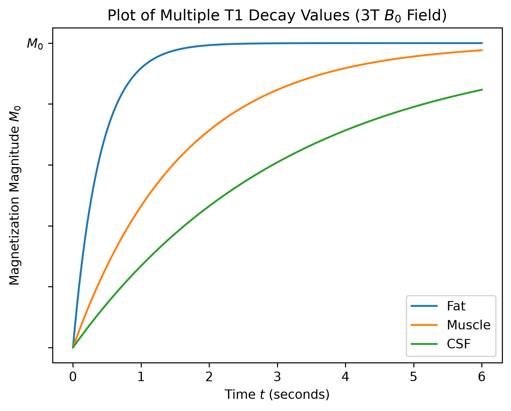

# MRI Pulse Sequence Modeling

## T1 Relaxation of Multiple Tissue types

With the relationship derived from the Bloch equations:
$$M_z(t)= M_0(1-e^{-t/T1})$$
we can visualize and compare T1 decay properties over a desired period for multiple tissue types as shown. The corresponding plot illustrates the result of increasing T1 times comparing fat tissue (approximately T1 = 400ms), muscle tissue (approximately T1 = 1600ms), and cerebrospinal fluid (approximately T1 = 3200ms). One can observe from this plot the drastic trend in the longitudinal recovery of the macroscopic magnetization vector $M_0$ with the increase in T1 value.   

  

